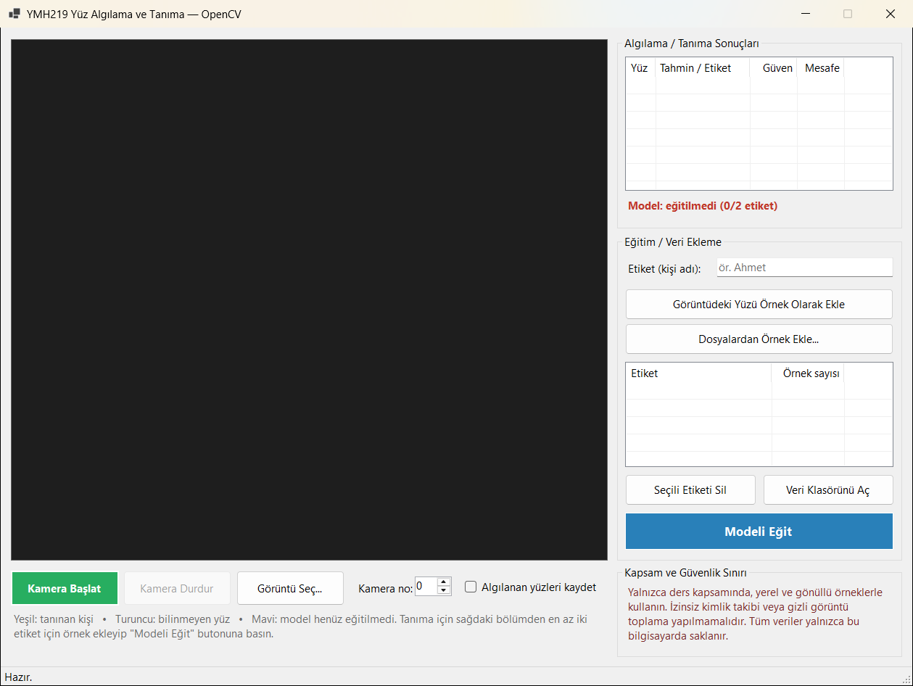
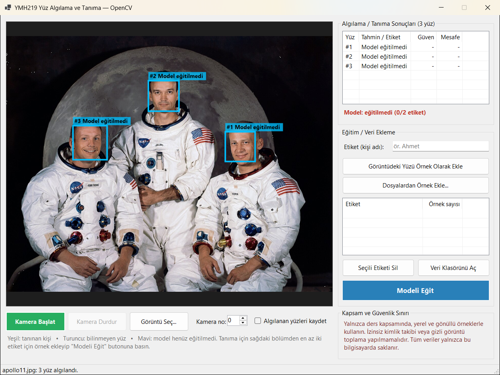

# YMH219 – OpenCV ile Yüz Algılama ve Tanıma

Nesne Tabanlı Programlama (YMH 219) dersi ek uygulama ödevi. **OpenCvSharp4** kütüphanesi ile kameradan veya dosyadan alınan görüntüde yüzleri algılayan (**Haar Cascade**), yüz bölgelerini dikdörtgenle işaretleyen ve öğrencinin oluşturduğu küçük yerel örnek kümesiyle eğitilen **LBPH** tanıyıcı ile etiket + güven skoru gösteren bir Windows Forms uygulamasıdır.

> ⚠️ **Kapsam ve güvenlik sınırı:** Uygulama yalnızca ders kapsamında, **yerel ve gönüllü örneklerle** kullanılmalıdır. Kamuya açık alanlarda izinsiz kimlik takibi, gizli görüntü toplama veya uzaktan izleme amacıyla kullanılmamalıdır. Tüm veriler yalnızca bilgisayarınızdaki `Belgeler\YMH219-FaceRecognition` klasöründe tutulur; hiçbir veri ağ üzerinden gönderilmez.

## Kullanılan Teknolojiler

| Teknoloji | Açıklama |
|---|---|
| C# / .NET 8 | `net8.0-windows` |
| Windows Forms | PictureBox, ListView, NumericUpDown, StatusStrip |
| **NuGet: `OpenCvSharp4.Windows`** | OpenCV 4 sarmalayıcısı + Windows yerel kütüphaneleri (VideoCapture, CascadeClassifier, `OpenCvSharp.Face.LBPHFaceRecognizer`) |
| **NuGet: `OpenCvSharp4.Extensions`** | `Mat` → `Bitmap` dönüşümü |
| `haarcascade_frontalface_default.xml` | OpenCV'nin önden yüz algılama modeli (Intel License, depoda `FaceRecognition/Models` altında) |

## Kurulum ve Çalıştırma

**Gereksinimler:** Windows 10/11 (64 bit), Visual Studio 2022 (17.8+) veya .NET 8 SDK, isteğe bağlı web kamerası.

```bash
git clone https://github.com/AHMETYAMAN23/YMH219-FaceRecognition.git
```

`FaceRecognition.sln` dosyasını Visual Studio ile açıp **F5** ile çalıştırın (NuGet paketleri otomatik geri yüklenir) ya da:

```bash
dotnet run --project FaceRecognition/FaceRecognition.csproj
```

## Kullanım

1. **Kamera Başlat** ile kamerayı açın (birden fazla kamera varsa "Kamera no" değerini değiştirin) veya **Görüntü Seç...** ile bir resim açın. Deneme için `samples/apollo11_crew.jpg` kullanılabilir.
2. Algılanan yüzler dikdörtgenle işaretlenir; sağdaki listede her yüzün etiketi, güven yüzdesi ve LBPH mesafesi görünür.
3. **Tanıma için eğitim (en az 2 etiket):**
   - "Etiket" kutusuna gönüllü kişinin adını yazın (ör. `Ahmet`).
   - Kamera açıkken farklı açılardan **Görüntüdeki Yüzü Örnek Olarak Ekle** butonuna 10–20 kez basın veya **Dosyalardan Örnek Ekle...** ile fotoğraf seçin.
   - İkinci gönüllü (veya kendi yüzünüzün farklı koşullardaki örnekleri — ör. `Ahmet_Gozluklu`) için aynı işlemi yapın.
   - **Modeli Eğit** butonuna basın. Model `Belgeler\YMH219-FaceRecognition\model` klasörüne kaydedilir ve uygulama yeniden açıldığında otomatik yüklenir.
4. Renkler: **yeşil** = tanınan kişi, **turuncu** = bilinmeyen yüz (mesafe eşiğin üstünde), **mavi** = model henüz eğitilmedi.

## Özellikler

**Asgari gereksinimler**
- Kamera görüntüsü veya seçilen resim PictureBox'ta gösterilir.
- Algılanan yüz bölgeleri dikdörtgenle işaretlenir.
- En az iki etiketle LBPH tabanlı tanıma; uygulama 2'den az etiketle eğitime izin vermez.
- Tahmin edilen etiket, **güven yüzdesi** ve LBPH **mesafe** değeri arayüzde gösterilir.
- **Kamera Başlat / Durdur** ve **Görüntü Seç** işlevleri.
- Kamera açılamadığında, model dosyası bulunamadığında veya resim okunamadığında kullanıcıya hata mesajı verilir.

**İsteğe bağlı geliştirmeler**
- "Algılanan yüzleri kaydet" seçeneği ile yüzlerin `detected_faces` klasörüne kaydedilmesi (saniyede en fazla bir kez).
- Aynı karede **birden fazla yüzün** işaretlenmesi ve numaralandırılması.
- Basit **eğitim/veri ekleme ekranı**: etiket listesi, örnek sayıları, etiket silme, veri klasörünü açma.

## Ekran Görüntüleri

| Uygulama arayüzü | Yüz algılama (birden fazla yüz) |
|---|---|
|  |  |

## Proje Yapısı ve Sınıf Tasarımı

```
FaceRecognition/
├── Program.cs
├── MainForm.cs                       Arayüz: kamera/görüntü, sonuç listesi, eğitim bölümü
├── Models/
│   ├── FaceResult.cs                 Yüz no, konum ve tanıma sonucu (record)
│   └── haarcascade_frontalface_default.xml
└── Services/
    ├── AppPaths.cs                   Veri klasörleri, ASCII dışı yol güvenliği
    ├── CameraService.cs              VideoCapture ile arka plan görevinde kare okuma
    ├── FaceDetector.cs               CascadeClassifier ile yüz algılama + yüz ön işleme
    ├── FaceDataset.cs                Etiket klasörlerinde yerel örnekler (ekle/sil/yükle)
    ├── FaceRecognizerService.cs      LBPH eğitim, tahmin, eşik, model kaydet/yükle
    └── FaceProcessor.cs              Algıla → tanı → çiz akışı (GDI+ ile Türkçe etiketler)
```

- Her sınıfın tek bir sorumluluğu vardır; form yalnızca servisleri birleştirir.
- Kamera kareleri **arka plan iş parçacığında** işlenir, arayüz `BeginInvoke` ile güncellenir; arayüz meşgulken gelen kareler atlanarak gecikme birikmesi önlenir.
- `Mat`, `CascadeClassifier`, `VideoCapture` ve tanıyıcı nesneleri `IDisposable` deseniyle serbest bırakılır.
- OpenCV'nin yerel fonksiyonları Türkçe karakterli yolları (ör. `Masaüstü`) açamayabileceği için görüntüler `ImDecode/ImEncode` ile okunup yazılır.

## Bilinen Sınırlamalar / Geliştirme Notları

- Haar Cascade yalnızca önden ve iyi aydınlatılmış yüzlerde güvenilirdir; yan profil, gözlük yansıması veya karanlık ortamda yüz kaçırılabilir.
- LBPH basit bir yöntemdir; az örnekle doğruluk sınırlıdır. Her etiket için farklı açı ve ışıkta 15+ örnek önerilir. "Bilinmiyor" eşiği varsayılan olarak 80 mesafedir.
- Ekran görüntülerinde yalnızca **yüz algılama** gösterilmiştir. Tanıma (etiket + güven skoru) için eğitim, ödev yönergesine uygun olarak öğrencinin kendisi/gönüllü örnekleri ile yerel olarak yapılmalıdır.
- `samples/apollo11_crew.jpg`: NASA tarafından yayımlanan kamu malı (public domain) Apollo 11 ekip fotoğrafıdır; yalnızca algılama testi içindir.

## Öğrenci Bilgileri

- **Ad Soyad:** Ahmet Yaman
- **Öğrenci No:** 250541014
- **Ders:** Nesne Tabanlı Programlama (YMH 219)
